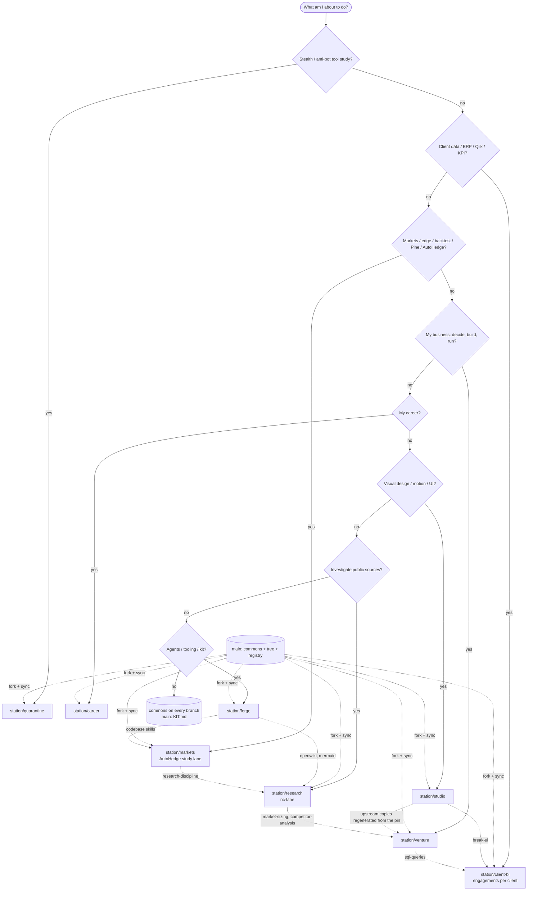

# stable-kit

owner: kit-root · status: CURRENT · date: 2026-10-16 · supersedes: none · audit: `python3 tools/kit/kit_check.py tree registry`

**What this is.** One private git repo that turns a stable of 28 upstream repos into eight ready-to-work
**stations**. `main` holds the shared core: the lean commons (one audit runner, one router, one brain, one map
toolset, one hook set, one skill set), the governance, mapping and brain programmes, this decision tree, the
registry of every upstream pin, and the kit tools. Each station is a branch forked from `main` that adds only its
own material: upstream method text and trees, gap skills, router rows, workflows and seeds. Open Claude in a
station's worktree and it sees that station's purpose, rules, router and skills, and nothing else.

Every one of the 360 upstream `SKILL.md` files is homed in exactly one station and routed by intent
(`SKILLS_INDEX.md`). Nothing is excluded: the three stealth tools are packed together in `station/quarantine`,
AutoHedge sits whole in a study lane in `station/markets`, and two apps with no job sit in the attic as registry
rows you can fetch on demand.

## The decision tree — what am I about to do?

Answer in order; the first "yes" wins. The order is the cost of putting the work in the wrong place, highest first.

<!-- KIT_TREE:BEGIN (kept equal to router/kit_tree.json and map/STATIONS.md by tools/kit/kit_check.py tree) -->
```
What am I about to do?
├─ Q0 Study camofox, Maxun, AIHawk/invisible_dots, or any stealth / anti-bot / fingerprinting tool?
│     └─ yes → station/quarantine        (read-only study; install/run asks you first)
├─ Q1 Touch a CLIENT's data, ERP, Qlik app, load script, KPI or dashboard?
│     └─ yes → station/client-bi         (engagements/<client>/ or a station/client-bi--<client> sub-branch)
├─ Q2 Markets: a trade idea, edge, backtest, journal, Pine/TradingView, AutoHedge?
│     └─ yes → station/markets           (AutoHedge = study lane, disarmed by default)
├─ Q3 MY business: decide what to build, build it, or run it (customers, CRM, invoices/BTW, billing, jobs, inbox)?
│     └─ yes → station/venture           (a second venture forks station/venture--<name>)
├─ Q4 My career: CV, applications, interviews, offers?
│     └─ yes → station/career            (dormant until used; career-ops / ai-job-search run in workspace mode)
├─ Q5 Visual / interaction design, motion, UI critique not owned by a product?
│     └─ yes → station/studio
├─ Q6 Find something out from PUBLIC sources (literature, a market, repos, screenshots/posts)?
│     └─ yes → station/research          (the only CC BY-NC lane)
├─ Q7 Improve the agents/tooling, trial a tool, ingest a new upstream, repin, maintain the kit?
│     └─ yes → station/forge
└─ none of the above (a quick question, a handoff, a delegation) → whichever station you are in: the commons is everywhere; on main read KIT.md
```
<!-- KIT_TREE:END -->


Dotted copy edges are cross-pollinated upstream copies, re-ingested from the same pin (byte-identical, one blob in
git), never station-to-station edits. Kit-authored shared method lives in `commons/packs/` on main.

On `main`, the router turns these leaves into `STATION: <name> — git worktree add ~/stations/<name> station/<name>`.
On a station branch a prompt that clearly belongs elsewhere prints `WRONG STATION? this looks like <x>`.

## The stations

| station | branch | purpose | knobs gov/map/brain | skills homed | workflows |
|---|---|---|---|---|---|
| quarantine | `station/quarantine` | Hold camofox-browser, Maxun and AIHawk (now invisible_dots) together, whole and readable, for study only. | core/XS/tiny | 1 | quarantine-study |
| client-bi | `station/client-bi` | Qlik/ERP consulting over client data: KPI builds that reconcile, script reviews, ERP source maps, dashboard QA. | standard/M/small | 1 | engagement-open, kpi-reconcile, qlik-review, erp-map, dashboard-review, reload-debug |
| markets | `station/markets` | Measure market edges honestly and draw them for a human: port-FROM finance methods, audit claims, study AutoHedge. | standard/M/small | 91 | edge-research, skill-port, claim-audit, journal-review, autohedge-study |
| venture | `station/venture` | Decide what to build, build it and run your own side business: discovery to launch, CRM, billing, scheduled jobs, inbox. | standard/M/small | 132 | idea-to-decision, prd, mvp-scaffold, launch-plan, service-up, billing-dryrun, weekly-ops |
| career | `station/career` | Job search on purpose: evaluate postings, draft applications that you send, prepare interviews (dormant until used). | core/S/tiny | 54 | job-eval, apply, interview-prep |
| studio | `station/studio` | Design as the product: briefs, prototypes, motion and detector-checked UI review. | core/S/tiny | 40 | design-pass, motion-review |
| research | `station/research` | Investigate from public sources with chain of custody: investigations, literature reviews (non-commercial lane), intake, repo mapping, market scans. | standard/M/small | 12 | deep-investigation, lit-review, intake, stable-map, market-scan |
| forge | `station/forge` | Make agents cheaper and better and maintain the kit: tool trials with denominators, wiki/autoresearch tools, gated reverse engineering, upstream intake, repin. | fleet/M/medium | 29 | tool-trial, optimize-loop, wiki-gen, reverse, upstream-intake, arch-review, kit-repin |

Skills homed sum to 360 = every census `SKILL.md` (`SKILLS_INDEX.md`, checked by `tools/kit/skills_index.py --check`).
Live branch facts (commits behind main, LOCK rows, last subject) are in `map/STATIONS.md`: shipped as a pre-assembly seed from the plan's branch list (`python3 tools/kit/assemble.py --seed-station-map`), re-rendered from the real branches by assembly step 5 (`python3 tools/map/gen_station_map.py --write`).

## Start here

```bash
unzip stable-kit.zip && cd stable-kit
python3 tools/kit/doctor.py                                  # report only: git, python, node, worktrees, bootstrap coverage
git worktree add ~/stations/markets station/markets          # one worktree per station you use
cd ~/stations/markets && claude                              # open Claude there: it loads that branch's CLAUDE.md, rules, router
```
Use one worktree per station. A working root that spans several stations loads the hooks of one branch only;
`doctor.py` reports that.

## Upstream clones (bootstrap)

Big upstream apps are not committed. They are `bootstrap` rows: a bare clone fetched at the exact 40-hex pin
from `registry/sources.json` into ONE cache shared by the kit checkout and every station worktree (the main
checkout's gitignored `.upstream/`, or `$STABLE_KIT_UPSTREAM`), never checked out inside a station. Run it from
the kit root or from any `~/stations/<x>`: both see the same pins.

```bash
python3 tools/kit/bootstrap.py --station venture --dry-run   # preview: url · sha · files_at_pin · cache path · present/absent
python3 tools/kit/bootstrap.py --station venture             # or --all, --attic, or <owner~repo> ...
python3 tools/kit/bootstrap.py --all --bundle-out ~/kit-bundles   # offline bundles for later transport
python3 tools/kit/bootstrap.py --all --from-bundle ~/kit-bundles  # restore without network
python3 tools/kit/runtree.py santifer~career-ops --workspace      # a run tree OUTSIDE the station (~/.stable-kit/run/...)
```
Run upstream code only in a run tree. `runtree.py --workspace` wires the kit floor hooks into that tree.

## Keep stations current, split one off

- Edit commons files on `main` only. Then, on each station: `python3 tools/kit/sync.py`. It merges `main`,
  regenerates GENERATED files on conflict, and aborts on any other conflict. It never rebases and never forces.
- New upstream version: `python3 tools/kit/repin.py --report <owner~repo> <sha>`, then `--apply` after it is green.
- Split a station into its own repo (a convenience; a branch is not a boundary):
  `bash tools/kit/split.sh station/<x> <dest-dir> [remote-url]`. Afterwards `git fetch kit && git merge kit/main`
  still syncs it, and `commons/MANIFEST.json` checks commons drift.

## Secrets

Every station ships a tracked `.env` with the variable NAMES and empty values, plus `.env.example`. The values are
yours: fill them, and commit them on your private copy if you want to. No hook blocks it (ORDER 5,
`governance/DECISIONS.md` DEC-core-0003). The built kit contains no secret value.

## Notes

- **Quarantine:** camofox-browser, Maxun and AIHawk/invisible_dots are held whole together in `station/quarantine`; reads are free, and any install or run inside them asks you first.
- **AutoHedge:** held whole in `station/markets:study/` with `study/AUTOHEDGE_STARTUP_NOTE.md`. Study it first. It is disarmed by default because `SOLANA_PRIVATE_KEY` is empty, and `execute_trade` asks before it runs while a key is set.
- **Hosted MCP:** the Reactive Resume (career) and Supabase (venture) entries are left as shipped, as hosted endpoints.
- **Telemetry:** every tool with telemetry has a row in `registry/telemetry.json`. A workflow never starts a tool whose row is `verified: false`.

More: `KIT.md` (how main, branches, sync, bootstrap, runtree, repin, split and zip work) · `UNZIP.md` ·
`registry/` (sources, homes, licences, telemetry, attic, quarantine, skill assignment) · `SKILLS_INDEX.md`.
