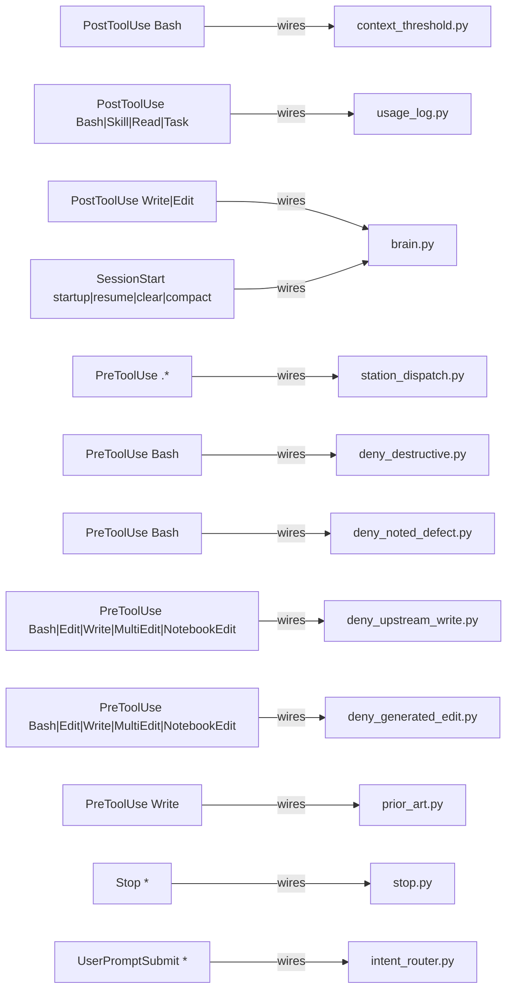

<!-- GENERATED by tools/map/gen_atlas.py from the station tree + map/*.json — run python3 tools/map/gen_atlas.py --write -->
owner: map/atlas_schema.json · status: GENERATED · date: see git log · supersedes: none · audit: python3 tools/map/gen_atlas.py --check

# Atlas

census: dir 16 · hook 12 · skill 11 · tool 50 · total 97 · upstream 6 · workflow 2

One id space: the mermaid ids below are the atlas ids (non-alphanumerics -> `_`). Where is X? `python3 tools/map/gen_atlas.py --show <id|word>`.

## Dirs and what is in them

65 nodes > cap 60: table instead of a hairball.

| from | kind | to | evidence |
|---|---|---|---|
| `skill:checkpoint` | in | `dir:.claude` | map/dirs.json:7 |
| `skill:closeout` | in | `dir:.claude` | map/dirs.json:7 |
| `skill:evo-guard` | in | `dir:.claude` | map/dirs.json:7 |
| `skill:handoff` | in | `dir:.claude` | map/dirs.json:7 |
| `skill:kit-maintain` | in | `dir:.claude` | map/dirs.json:7 |
| `skill:re-legal-gate` | in | `dir:.claude` | map/dirs.json:7 |
| `skill:summon` | in | `dir:.claude` | map/dirs.json:7 |
| `skill:telemetry-audit` | in | `dir:.claude` | map/dirs.json:7 |
| `skill:tier` | in | `dir:.claude` | map/dirs.json:7 |
| `skill:tool-trial` | in | `dir:.claude` | map/dirs.json:7 |
| `skill:upstream-intake` | in | `dir:.claude` | map/dirs.json:7 |
| `tool:.claude/hooks/_cmdscan.py` | in | `dir:.claude` | map/dirs.json:7 |
| `tool:.claude/hooks/_release.py` | in | `dir:.claude` | map/dirs.json:7 |
| `tool:.claude/hooks/_report.py` | in | `dir:.claude` | map/dirs.json:7 |
| `tool:.claude/hooks/act_gate.py` | in | `dir:.claude` | map/dirs.json:7 |
| `tool:.claude/hooks/connector_scope.py` | in | `dir:.claude` | map/dirs.json:7 |
| `tool:.claude/hooks/context_threshold.py` | in | `dir:.claude` | map/dirs.json:7 |
| `tool:.claude/hooks/deny_destructive.py` | in | `dir:.claude` | map/dirs.json:7 |
| `tool:.claude/hooks/deny_noted_defect.py` | in | `dir:.claude` | map/dirs.json:7 |
| `tool:.claude/hooks/deny_upstream_write.py` | in | `dir:.claude` | map/dirs.json:7 |
| `tool:.claude/hooks/intent_router.py` | in | `dir:.claude` | map/dirs.json:7 |
| `tool:.claude/hooks/quarantine_gate.py` | in | `dir:.claude` | map/dirs.json:7 |
| `tool:.claude/hooks/station_dispatch.py` | in | `dir:.claude` | map/dirs.json:7 |
| `tool:.claude/hooks/stop.py` | in | `dir:.claude` | map/dirs.json:7 |
| `tool:tools/brain.py` | in | `dir:tools` | map/dirs.json:177 |
| `tool:tools/gov/_gov.py` | in | `dir:tools` | map/dirs.json:177 |
| `tool:tools/gov/gen_manifest.py` | in | `dir:tools` | map/dirs.json:177 |
| `tool:tools/gov/gen_ownership.py` | in | `dir:tools` | map/dirs.json:177 |
| `tool:tools/gov/gov_check.py` | in | `dir:tools` | map/dirs.json:177 |
| `tool:tools/gov/new_row.py` | in | `dir:tools` | map/dirs.json:177 |
| `tool:tools/kit/_kit.py` | in | `dir:tools` | map/dirs.json:177 |
| `tool:tools/kit/assemble.py` | in | `dir:tools` | map/dirs.json:177 |
| `tool:tools/kit/bootstrap.py` | in | `dir:tools` | map/dirs.json:177 |
| `tool:tools/kit/doctor.py` | in | `dir:tools` | map/dirs.json:177 |
| `tool:tools/kit/kit_check.py` | in | `dir:tools` | map/dirs.json:177 |
| `tool:tools/kit/make_zip.py` | in | `dir:tools` | map/dirs.json:177 |
| `tool:tools/kit/repin.py` | in | `dir:tools` | map/dirs.json:177 |
| `tool:tools/kit/runtree.py` | in | `dir:tools` | map/dirs.json:177 |
| `tool:tools/kit/skills_index.py` | in | `dir:tools` | map/dirs.json:177 |
| `tool:tools/kit/sync.py` | in | `dir:tools` | map/dirs.json:177 |
| `tool:tools/map/_common.py` | in | `dir:tools` | map/dirs.json:177 |
| `tool:tools/map/check_paths.py` | in | `dir:tools` | map/dirs.json:177 |
| `tool:tools/map/find.py` | in | `dir:tools` | map/dirs.json:177 |
| `tool:tools/map/gen_atlas.py` | in | `dir:tools` | map/dirs.json:177 |
| `tool:tools/map/gen_dir_readmes.py` | in | `dir:tools` | map/dirs.json:177 |
| `tool:tools/map/gen_solutions.py` | in | `dir:tools` | map/dirs.json:177 |
| `tool:tools/map/gen_station_map.py` | in | `dir:tools` | map/dirs.json:177 |
| `tool:tools/map/hooks/deny_generated_edit.py` | in | `dir:tools` | map/dirs.json:177 |
| `tool:tools/map/hooks/prior_art.py` | in | `dir:tools` | map/dirs.json:177 |
| `tool:tools/map/hooks/usage_log.py` | in | `dir:tools` | map/dirs.json:177 |
| `tool:tools/map/map_check.py` | in | `dir:tools` | map/dirs.json:177 |
| `tool:tools/map/upstream_check.py` | in | `dir:tools` | map/dirs.json:177 |
| `tool:tools/map/usage_map.py` | in | `dir:tools` | map/dirs.json:177 |
| `tool:tools/station/forge_check.py` | in | `dir:tools` | map/dirs.json:177 |
| `tool:tools/station_audit.py` | in | `dir:tools` | map/dirs.json:177 |
| `tool:tools/upstream/_uplib.py` | in | `dir:tools` | map/dirs.json:177 |
| `tool:tools/upstream/ingest.py` | in | `dir:tools` | map/dirs.json:177 |
| `tool:tools/upstream/notice.py` | in | `dir:tools` | map/dirs.json:177 |
| `tool:tools/upstream/skill_routes.py` | in | `dir:tools` | map/dirs.json:177 |
| `tool:tools/upstream/upstream_checks.py` | in | `dir:tools` | map/dirs.json:177 |
| `tool:tools/upstream/workflows_check.py` | in | `dir:tools` | map/dirs.json:177 |
| `workflow:_template` | in | `dir:.claude` | map/dirs.json:7 |
| `workflow:orient` | in | `dir:.claude` | map/dirs.json:7 |

## Hooks and the tools they wire

## Intent -> workflow/skill -> tool -> upstream

61 nodes > cap 60: table instead of a hairball.

| from | kind | to | evidence |
|---|---|---|---|
| `skill:checkpoint` | runs | `tool:tools/station_audit.py` | .claude/skills/checkpoint/SKILL.md:12 |
| `skill:closeout` | runs | `tool:tools/gov/gen_manifest.py` | .claude/skills/closeout/SKILL.md:19 |
| `skill:closeout` | runs | `tool:tools/gov/new_row.py` | .claude/skills/closeout/SKILL.md:30 |
| `skill:closeout` | runs | `tool:tools/station_audit.py` | .claude/skills/closeout/SKILL.md:39 |
| `skill:closeout` | runs | `tool:tools/upstream/notice.py` | .claude/skills/closeout/SKILL.md:18 |
| `skill:closeout` | runs | `tool:tools/upstream/skill_routes.py` | .claude/skills/closeout/SKILL.md:18 |
| `skill:evo-guard` | runs | `tool:tools/station/forge_check.py` | .claude/skills/evo-guard/SKILL.md:30 |
| `skill:evo-guard` | ports-from | `upstream:evo-hq~evo` | .claude/skills/evo-guard/SKILL.md:12 |
| `skill:handoff` | runs | `tool:tools/station_audit.py` | .claude/skills/handoff/SKILL.md:19 |
| `skill:kit-maintain` | runs | `tool:tools/kit/bootstrap.py` | .claude/skills/kit-maintain/SKILL.md:12 |
| `skill:kit-maintain` | runs | `tool:tools/kit/repin.py` | .claude/skills/kit-maintain/SKILL.md:28 |
| `skill:kit-maintain` | runs | `tool:tools/kit/sync.py` | .claude/skills/kit-maintain/SKILL.md:22 |
| `skill:kit-maintain` | runs | `tool:tools/station/forge_check.py` | .claude/skills/kit-maintain/SKILL.md:26 |
| `skill:kit-maintain` | runs | `tool:tools/station_audit.py` | .claude/skills/kit-maintain/SKILL.md:23 |
| `skill:kit-maintain` | runs | `tool:tools/upstream/ingest.py` | .claude/skills/kit-maintain/SKILL.md:21 |
| `skill:re-legal-gate` | runs | `tool:tools/kit/runtree.py` | .claude/skills/re-legal-gate/SKILL.md:21 |
| `skill:re-legal-gate` | runs | `tool:tools/station/forge_check.py` | .claude/skills/re-legal-gate/SKILL.md:26 |
| `skill:re-legal-gate` | ports-from | `upstream:morluto~rea` | .claude/skills/re-legal-gate/SKILL.md:7 |
| `skill:telemetry-audit` | runs | `tool:tools/station/forge_check.py` | .claude/skills/telemetry-audit/SKILL.md:28 |
| `skill:tool-trial` | runs | `tool:tools/kit/runtree.py` | .claude/skills/tool-trial/SKILL.md:20 |
| `skill:tool-trial` | runs | `tool:tools/station/forge_check.py` | .claude/skills/tool-trial/SKILL.md:36 |
| `skill:tool-trial` | ports-from | `upstream:styler-ai~ProjectAtlas` | .claude/skills/tool-trial/SKILL.md:24 |
| `skill:upstream-intake` | runs | `tool:tools/kit/bootstrap.py` | .claude/skills/upstream-intake/SKILL.md:11 |
| `skill:upstream-intake` | runs | `tool:tools/station_audit.py` | .claude/skills/upstream-intake/SKILL.md:60 |
| `skill:upstream-intake` | runs | `tool:tools/upstream/ingest.py` | .claude/skills/upstream-intake/SKILL.md:38 |
| `skill:upstream-intake` | runs | `tool:tools/upstream/notice.py` | .claude/skills/upstream-intake/SKILL.md:57 |
| `skill:upstream-intake` | runs | `tool:tools/upstream/skill_routes.py` | .claude/skills/upstream-intake/SKILL.md:59 |
| `skill:upstream-intake` | runs | `tool:tools/upstream/upstream_checks.py` | .claude/skills/upstream-intake/SKILL.md:56 |
| `tool:.claude/hooks/deny_noted_defect.py` | runs | `tool:tools/gov/new_row.py` | .claude/hooks/deny_noted_defect.py:115 |
| `tool:.claude/hooks/deny_upstream_write.py` | runs | `tool:tools/upstream/ingest.py` | .claude/hooks/deny_upstream_write.py:176 |
| `tool:.claude/hooks/deny_upstream_write.py` | runs | `tool:tools/upstream/skill_routes.py` | .claude/hooks/deny_upstream_write.py:284 |
| `tool:.claude/hooks/intent_router.py` | runs | `tool:tools/brain.py` | .claude/hooks/intent_router.py:27 |
| `tool:.claude/hooks/intent_router.py` | runs | `tool:tools/upstream/skill_routes.py` | .claude/hooks/intent_router.py:493 |
| `tool:.claude/hooks/quarantine_gate.py` | runs | `tool:tools/station_audit.py` | .claude/hooks/quarantine_gate.py:211 |
| `tool:.claude/hooks/stop.py` | runs | `tool:tools/brain.py` | .claude/hooks/stop.py:13 |
| `tool:tools/brain.py` | runs | `tool:tools/map/gen_station_map.py` | tools/brain.py:441 |
| `tool:tools/brain.py` | runs | `tool:tools/station_audit.py` | tools/brain.py:894 |
| `tool:tools/gov/_gov.py` | runs | `tool:.claude/hooks/_cmdscan.py` | tools/gov/_gov.py:450 |
| `tool:tools/gov/_gov.py` | runs | `tool:.claude/hooks/_release.py` | tools/gov/_gov.py:450 |
| `tool:tools/gov/_gov.py` | runs | `tool:.claude/hooks/_report.py` | tools/gov/_gov.py:450 |
| `tool:tools/gov/_gov.py` | runs | `tool:.claude/hooks/context_threshold.py` | tools/gov/_gov.py:452 |
| `tool:tools/gov/_gov.py` | runs | `tool:.claude/hooks/deny_destructive.py` | tools/gov/_gov.py:451 |
| `tool:tools/gov/_gov.py` | runs | `tool:.claude/hooks/deny_noted_defect.py` | tools/gov/_gov.py:452 |
| `tool:tools/gov/_gov.py` | runs | `tool:.claude/hooks/intent_router.py` | tools/gov/_gov.py:451 |
| `tool:tools/gov/_gov.py` | runs | `tool:.claude/hooks/station_dispatch.py` | tools/gov/_gov.py:453 |
| `tool:tools/gov/_gov.py` | runs | `tool:.claude/hooks/stop.py` | tools/gov/_gov.py:453 |
| `tool:tools/gov/_gov.py` | runs | `tool:tools/gov/gen_manifest.py` | tools/gov/_gov.py:449 |
| `tool:tools/gov/_gov.py` | runs | `tool:tools/gov/gen_ownership.py` | tools/gov/_gov.py:448 |
| `tool:tools/gov/_gov.py` | runs | `tool:tools/gov/gov_check.py` | tools/gov/_gov.py:448 |
| `tool:tools/gov/_gov.py` | runs | `tool:tools/gov/new_row.py` | tools/gov/_gov.py:449 |
| `tool:tools/gov/_gov.py` | runs | `tool:tools/map/_common.py` | tools/gov/_gov.py:14 |
| `tool:tools/gov/_gov.py` | runs | `tool:tools/station_audit.py` | tools/gov/_gov.py:448 |
| `tool:tools/gov/gen_manifest.py` | runs | `tool:tools/gov/gen_ownership.py` | tools/gov/gen_manifest.py:95 |
| `tool:tools/gov/gov_check.py` | runs | `tool:.claude/hooks/act_gate.py` | tools/gov/gov_check.py:1066 |
| `tool:tools/gov/gov_check.py` | runs | `tool:.claude/hooks/context_threshold.py` | tools/gov/gov_check.py:1072 |
| `tool:tools/gov/gov_check.py` | runs | `tool:.claude/hooks/deny_destructive.py` | tools/gov/gov_check.py:1081 |
| `tool:tools/gov/gov_check.py` | runs | `tool:.claude/hooks/station_dispatch.py` | tools/gov/gov_check.py:661 |
| `tool:tools/gov/gov_check.py` | runs | `tool:.claude/hooks/stop.py` | tools/gov/gov_check.py:1080 |
| `tool:tools/gov/gov_check.py` | runs | `tool:tools/gov/gen_manifest.py` | tools/gov/gov_check.py:863 |
| `tool:tools/gov/gov_check.py` | runs | `tool:tools/kit/sync.py` | tools/gov/gov_check.py:886 |
| `tool:tools/gov/gov_check.py` | runs | `tool:tools/map/_common.py` | tools/gov/gov_check.py:1101 |
| `tool:tools/gov/new_row.py` | runs | `tool:tools/station_audit.py` | tools/gov/new_row.py:94 |
| `tool:tools/kit/assemble.py` | runs | `tool:tools/brain.py` | tools/kit/assemble.py:59 |
| `tool:tools/kit/assemble.py` | runs | `tool:tools/gov/gen_manifest.py` | tools/kit/assemble.py:406 |
| `tool:tools/kit/assemble.py` | runs | `tool:tools/gov/gen_ownership.py` | tools/kit/assemble.py:59 |
| `tool:tools/kit/assemble.py` | runs | `tool:tools/kit/kit_check.py` | tools/kit/assemble.py:333 |
| `tool:tools/kit/assemble.py` | runs | `tool:tools/kit/skills_index.py` | tools/kit/assemble.py:345 |
| `tool:tools/kit/assemble.py` | runs | `tool:tools/kit/sync.py` | tools/kit/assemble.py:578 |
| `tool:tools/kit/assemble.py` | runs | `tool:tools/map/gen_station_map.py` | tools/kit/assemble.py:415 |
| `tool:tools/kit/assemble.py` | runs | `tool:tools/map/map_check.py` | tools/kit/assemble.py:59 |
| `tool:tools/kit/assemble.py` | runs | `tool:tools/station_audit.py` | tools/kit/assemble.py:218 |
| `tool:tools/kit/assemble.py` | runs | `tool:tools/upstream/notice.py` | tools/kit/assemble.py:60 |
| `tool:tools/kit/assemble.py` | runs | `tool:tools/upstream/skill_routes.py` | tools/kit/assemble.py:61 |
| `tool:tools/kit/bootstrap.py` | runs | `tool:tools/kit/runtree.py` | tools/kit/bootstrap.py:8 |
| `tool:tools/kit/doctor.py` | runs | `tool:tools/kit/bootstrap.py` | tools/kit/doctor.py:97 |
| `tool:tools/kit/doctor.py` | runs | `tool:tools/station_audit.py` | tools/kit/doctor.py:100 |
| `tool:tools/kit/kit_check.py` | runs | `tool:tools/kit/assemble.py` | tools/kit/kit_check.py:118 |
| `tool:tools/kit/kit_check.py` | runs | `tool:tools/map/gen_station_map.py` | tools/kit/kit_check.py:338 |
| `tool:tools/kit/repin.py` | runs | `tool:tools/kit/bootstrap.py` | tools/kit/repin.py:95 |
| `tool:tools/kit/repin.py` | runs | `tool:tools/station_audit.py` | tools/kit/repin.py:138 |
| `tool:tools/kit/repin.py` | runs | `tool:tools/upstream/ingest.py` | tools/kit/repin.py:163 |
| `tool:tools/kit/runtree.py` | runs | `tool:.claude/hooks/deny_destructive.py` | tools/kit/runtree.py:71 |
| `tool:tools/kit/runtree.py` | runs | `tool:.claude/hooks/station_dispatch.py` | tools/kit/runtree.py:72 |
| `tool:tools/kit/runtree.py` | runs | `tool:tools/kit/bootstrap.py` | tools/kit/runtree.py:86 |
| `tool:tools/kit/sync.py` | runs | `tool:tools/brain.py` | tools/kit/sync.py:46 |
| `tool:tools/kit/sync.py` | runs | `tool:tools/gov/gen_ownership.py` | tools/kit/sync.py:43 |
| `tool:tools/kit/sync.py` | runs | `tool:tools/map/map_check.py` | tools/kit/sync.py:45 |
| `tool:tools/kit/sync.py` | runs | `tool:tools/station_audit.py` | tools/kit/sync.py:255 |
| `tool:tools/kit/sync.py` | runs | `tool:tools/upstream/notice.py` | tools/kit/sync.py:47 |
| `tool:tools/kit/sync.py` | runs | `tool:tools/upstream/skill_routes.py` | tools/kit/sync.py:48 |
| `tool:tools/map/_common.py` | runs | `tool:tools/gov/_gov.py` | tools/map/_common.py:8 |
| `tool:tools/map/gen_solutions.py` | runs | `tool:tools/map/find.py` | tools/map/gen_solutions.py:32 |
| `tool:tools/map/gen_station_map.py` | runs | `tool:tools/kit/sync.py` | tools/map/gen_station_map.py:139 |
| `tool:tools/map/hooks/deny_generated_edit.py` | runs | `tool:tools/map/gen_atlas.py` | tools/map/hooks/deny_generated_edit.py:90 |
| `tool:tools/map/hooks/deny_generated_edit.py` | runs | `tool:tools/map/gen_solutions.py` | tools/map/hooks/deny_generated_edit.py:89 |
| `tool:tools/map/hooks/deny_generated_edit.py` | runs | `tool:tools/map/map_check.py` | tools/map/hooks/deny_generated_edit.py:80 |
| `tool:tools/map/hooks/prior_art.py` | runs | `tool:tools/brain.py` | tools/map/hooks/prior_art.py:7 |
| `tool:tools/map/hooks/prior_art.py` | runs | `tool:tools/map/find.py` | tools/map/hooks/prior_art.py:68 |
| `tool:tools/map/hooks/usage_log.py` | runs | `tool:tools/map/find.py` | tools/map/hooks/usage_log.py:81 |
| `tool:tools/map/hooks/usage_log.py` | runs | `tool:tools/map/usage_map.py` | tools/map/hooks/usage_log.py:7 |
| `tool:tools/map/map_check.py` | runs | `tool:tools/brain.py` | tools/map/map_check.py:8 |
| `tool:tools/map/map_check.py` | runs | `tool:tools/gov/gen_ownership.py` | tools/map/map_check.py:8 |
| `tool:tools/map/map_check.py` | runs | `tool:tools/kit/sync.py` | tools/map/map_check.py:9 |
| `tool:tools/map/map_check.py` | runs | `tool:tools/map/check_paths.py` | tools/map/map_check.py:31 |
| `tool:tools/map/map_check.py` | runs | `tool:tools/map/gen_atlas.py` | tools/map/map_check.py:35 |
| `tool:tools/map/map_check.py` | runs | `tool:tools/map/gen_dir_readmes.py` | tools/map/map_check.py:34 |
| `tool:tools/map/map_check.py` | runs | `tool:tools/map/gen_solutions.py` | tools/map/map_check.py:32 |
| `tool:tools/map/map_check.py` | runs | `tool:tools/map/gen_station_map.py` | tools/map/map_check.py:35 |
| `tool:tools/map/map_check.py` | runs | `tool:tools/map/upstream_check.py` | tools/map/map_check.py:31 |
| `tool:tools/map/map_check.py` | runs | `tool:tools/map/usage_map.py` | tools/map/map_check.py:113 |
| `tool:tools/map/usage_map.py` | runs | `tool:tools/map/hooks/usage_log.py` | tools/map/usage_map.py:10 |
| `tool:tools/map/usage_map.py` | runs | `tool:tools/map/map_check.py` | tools/map/usage_map.py:83 |
| `tool:tools/station_audit.py` | runs | `tool:.claude/hooks/context_threshold.py` | tools/station_audit.py:323 |
| `tool:tools/station_audit.py` | runs | `tool:.claude/hooks/stop.py` | tools/station_audit.py:319 |
| `tool:tools/upstream/_uplib.py` | runs | `tool:tools/map/_common.py` | tools/upstream/_uplib.py:8 |
| `tool:tools/upstream/ingest.py` | runs | `tool:tools/kit/bootstrap.py` | tools/upstream/ingest.py:21 |
| `tool:tools/upstream/notice.py` | runs | `tool:tools/kit/bootstrap.py` | tools/upstream/notice.py:40 |
| `tool:tools/upstream/skill_routes.py` | runs | `tool:.claude/hooks/intent_router.py` | tools/upstream/skill_routes.py:905 |
| `tool:tools/upstream/skill_routes.py` | runs | `tool:tools/kit/skills_index.py` | tools/upstream/skill_routes.py:949 |
| `tool:tools/upstream/upstream_checks.py` | runs | `tool:tools/gov/_gov.py` | tools/upstream/upstream_checks.py:99 |
| `tool:tools/upstream/upstream_checks.py` | runs | `tool:tools/kit/bootstrap.py` | tools/upstream/upstream_checks.py:435 |
| `tool:tools/upstream/upstream_checks.py` | runs | `tool:tools/kit/repin.py` | tools/upstream/upstream_checks.py:284 |
| `tool:tools/upstream/upstream_checks.py` | runs | `tool:tools/upstream/ingest.py` | tools/upstream/upstream_checks.py:138 |
| `tool:tools/upstream/workflows_check.py` | runs | `tool:tools/station_audit.py` | tools/upstream/workflows_check.py:321 |
| `workflow:_template` | runs | `tool:tools/station_audit.py` | .claude/workflows/_template.js:24 |
| `workflow:orient` | runs | `tool:tools/station_audit.py` | .claude/workflows/orient.js:19 |
