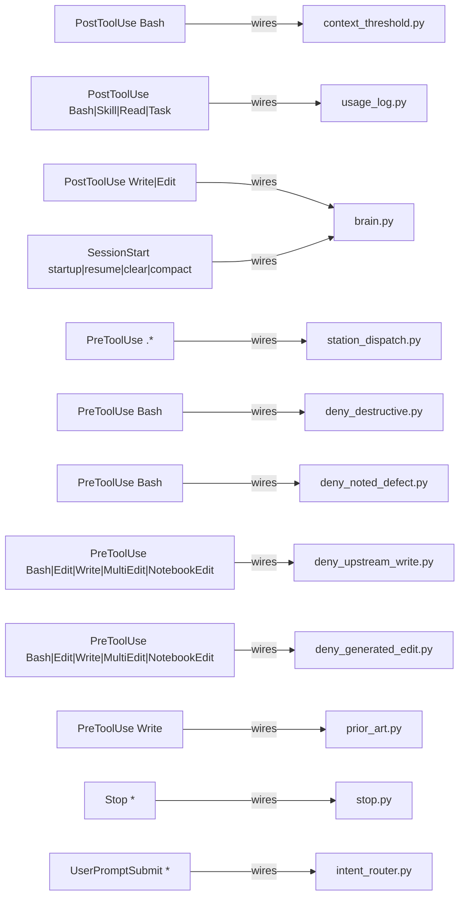

<!-- GENERATED by tools/map/gen_atlas.py from the station tree + map/*.json — run python3 tools/map/gen_atlas.py --write -->
owner: map/atlas_schema.json · status: GENERATED · date: see git log · supersedes: none · audit: python3 tools/map/gen_atlas.py --check

# Atlas

census: dir 18 · hook 12 · intent 14 · skill 9 · tool 87 · total 142 · workflow 2

One id space: the mermaid ids below are the atlas ids (non-alphanumerics -> `_`). Where is X? `python3 tools/map/gen_atlas.py --show <id|word>`.

## Dirs and what is in them

100 nodes > cap 60: table instead of a hairball.

| from | kind | to | evidence |
|---|---|---|---|
| `skill:checkpoint` | in | `dir:.claude` | map/dirs.json:7 |
| `skill:closeout` | in | `dir:.claude` | map/dirs.json:7 |
| `skill:design-review` | in | `dir:.claude` | map/dirs.json:7 |
| `skill:handoff` | in | `dir:.claude` | map/dirs.json:7 |
| `skill:shared-market-scan` | in | `dir:.claude` | map/dirs.json:7 |
| `skill:site-protection` | in | `dir:.claude` | map/dirs.json:7 |
| `skill:summon` | in | `dir:.claude` | map/dirs.json:7 |
| `skill:tier` | in | `dir:.claude` | map/dirs.json:7 |
| `skill:upstream-intake` | in | `dir:.claude` | map/dirs.json:7 |
| `tool:.claude/hooks/_cmdscan.py` | in | `dir:.claude` | map/dirs.json:7 |
| `tool:.claude/hooks/_release.py` | in | `dir:.claude` | map/dirs.json:7 |
| `tool:.claude/hooks/_report.py` | in | `dir:.claude` | map/dirs.json:7 |
| `tool:.claude/hooks/act_gate.py` | in | `dir:.claude` | map/dirs.json:7 |
| `tool:.claude/hooks/connector_scope.py` | in | `dir:.claude` | map/dirs.json:7 |
| `tool:.claude/hooks/context_threshold.py` | in | `dir:.claude` | map/dirs.json:7 |
| `tool:.claude/hooks/deny_destructive.py` | in | `dir:.claude` | map/dirs.json:7 |
| `tool:.claude/hooks/deny_noted_defect.py` | in | `dir:.claude` | map/dirs.json:7 |
| `tool:.claude/hooks/deny_upstream_write.py` | in | `dir:.claude` | map/dirs.json:7 |
| `tool:.claude/hooks/intent_router.py` | in | `dir:.claude` | map/dirs.json:7 |
| `tool:.claude/hooks/quarantine_gate.py` | in | `dir:.claude` | map/dirs.json:7 |
| `tool:.claude/hooks/station_dispatch.py` | in | `dir:.claude` | map/dirs.json:7 |
| `tool:.claude/hooks/stop.py` | in | `dir:.claude` | map/dirs.json:7 |
| `tool:tools/brain.py` | in | `dir:tools` | map/dirs.json:199 |
| `tool:tools/design/contrast.py` | in | `dir:tools` | map/dirs.json:199 |
| `tool:tools/design/design_catalog.py` | in | `dir:tools` | map/dirs.json:199 |
| `tool:tools/design/detector/__init__.py` | in | `dir:tools` | map/dirs.json:199 |
| `tool:tools/design/detector/color.py` | in | `dir:tools` | map/dirs.json:199 |
| `tool:tools/design/detector/css.py` | in | `dir:tools` | map/dirs.json:199 |
| `tool:tools/design/detector/design_md.py` | in | `dir:tools` | map/dirs.json:199 |
| `tool:tools/design/detector/detect.py` | in | `dir:tools` | map/dirs.json:199 |
| `tool:tools/design/detector/dom.py` | in | `dir:tools` | map/dirs.json:199 |
| `tool:tools/design/detector/engine.py` | in | `dir:tools` | map/dirs.json:199 |
| `tool:tools/design/detector/ignores.py` | in | `dir:tools` | map/dirs.json:199 |
| `tool:tools/design/detector/port_map.py` | in | `dir:tools` | map/dirs.json:199 |
| `tool:tools/design/detector/regex_engine.py` | in | `dir:tools` | map/dirs.json:199 |
| `tool:tools/design/detector/registry.py` | in | `dir:tools` | map/dirs.json:199 |
| `tool:tools/design/detector/rendered.py` | in | `dir:tools` | map/dirs.json:199 |
| `tool:tools/design/detector/rules_color.py` | in | `dir:tools` | map/dirs.json:199 |
| `tool:tools/design/detector/rules_layout.py` | in | `dir:tools` | map/dirs.json:199 |
| `tool:tools/design/detector/rules_motion_copy.py` | in | `dir:tools` | map/dirs.json:199 |
| `tool:tools/design/detector/rules_type.py` | in | `dir:tools` | map/dirs.json:199 |
| `tool:tools/design/detector/score.py` | in | `dir:tools` | map/dirs.json:199 |
| `tool:tools/design/detector/tailwind.py` | in | `dir:tools` | map/dirs.json:199 |
| `tool:tools/design/detector/tests/__init__.py` | in | `dir:tools` | map/dirs.json:199 |
| `tool:tools/design/detector/tests/parity.py` | in | `dir:tools` | map/dirs.json:199 |
| `tool:tools/design/detector/tests/test_css_lengths.py` | in | `dir:tools` | map/dirs.json:199 |
| `tool:tools/design/detector/tests/test_fragments.py` | in | `dir:tools` | map/dirs.json:199 |
| `tool:tools/design/detector/tests/test_regex_engine.py` | in | `dir:tools` | map/dirs.json:199 |
| `tool:tools/design/detector/tests/test_rendered.py` | in | `dir:tools` | map/dirs.json:199 |
| `tool:tools/design/detector/tests/test_rules_color.py` | in | `dir:tools` | map/dirs.json:199 |
| `tool:tools/design/detector/tests/test_rules_layout.py` | in | `dir:tools` | map/dirs.json:199 |
| `tool:tools/design/detector/tests/test_rules_motion_copy.py` | in | `dir:tools` | map/dirs.json:199 |
| `tool:tools/design/detector/tests/test_rules_type.py` | in | `dir:tools` | map/dirs.json:199 |
| `tool:tools/design/detector/tests/test_static_approx.py` | in | `dir:tools` | map/dirs.json:199 |
| `tool:tools/design/handoff.py` | in | `dir:tools` | map/dirs.json:199 |
| `tool:tools/gov/_gov.py` | in | `dir:tools` | map/dirs.json:199 |
| `tool:tools/gov/carry_design.py` | in | `dir:tools` | map/dirs.json:199 |
| `tool:tools/gov/gen_manifest.py` | in | `dir:tools` | map/dirs.json:199 |
| `tool:tools/gov/gen_ownership.py` | in | `dir:tools` | map/dirs.json:199 |
| `tool:tools/gov/gov_check.py` | in | `dir:tools` | map/dirs.json:199 |
| `tool:tools/gov/new_row.py` | in | `dir:tools` | map/dirs.json:199 |
| `tool:tools/kit/_kit.py` | in | `dir:tools` | map/dirs.json:199 |
| `tool:tools/kit/assemble.py` | in | `dir:tools` | map/dirs.json:199 |
| `tool:tools/kit/bootstrap.py` | in | `dir:tools` | map/dirs.json:199 |
| `tool:tools/kit/doctor.py` | in | `dir:tools` | map/dirs.json:199 |
| `tool:tools/kit/held_modes.py` | in | `dir:tools` | map/dirs.json:199 |
| `tool:tools/kit/kit_check.py` | in | `dir:tools` | map/dirs.json:199 |
| `tool:tools/kit/make_zip.py` | in | `dir:tools` | map/dirs.json:199 |
| `tool:tools/kit/repin.py` | in | `dir:tools` | map/dirs.json:199 |
| `tool:tools/kit/runtree.py` | in | `dir:tools` | map/dirs.json:199 |
| `tool:tools/kit/skills_index.py` | in | `dir:tools` | map/dirs.json:199 |
| `tool:tools/kit/sync.py` | in | `dir:tools` | map/dirs.json:199 |
| `tool:tools/map/_common.py` | in | `dir:tools` | map/dirs.json:199 |
| `tool:tools/map/check_paths.py` | in | `dir:tools` | map/dirs.json:199 |
| `tool:tools/map/find.py` | in | `dir:tools` | map/dirs.json:199 |
| `tool:tools/map/gen_atlas.py` | in | `dir:tools` | map/dirs.json:199 |
| `tool:tools/map/gen_dir_readmes.py` | in | `dir:tools` | map/dirs.json:199 |
| `tool:tools/map/gen_solutions.py` | in | `dir:tools` | map/dirs.json:199 |
| `tool:tools/map/gen_station_map.py` | in | `dir:tools` | map/dirs.json:199 |
| `tool:tools/map/hooks/deny_generated_edit.py` | in | `dir:tools` | map/dirs.json:199 |
| `tool:tools/map/hooks/prior_art.py` | in | `dir:tools` | map/dirs.json:199 |
| `tool:tools/map/hooks/usage_log.py` | in | `dir:tools` | map/dirs.json:199 |
| `tool:tools/map/map_check.py` | in | `dir:tools` | map/dirs.json:199 |
| `tool:tools/map/upstream_check.py` | in | `dir:tools` | map/dirs.json:199 |
| `tool:tools/map/usage_map.py` | in | `dir:tools` | map/dirs.json:199 |
| `tool:tools/protect/self_check.py` | in | `dir:tools` | map/dirs.json:199 |
| `tool:tools/research/custody.py` | in | `dir:tools` | map/dirs.json:199 |
| `tool:tools/research/sizing.py` | in | `dir:tools` | map/dirs.json:199 |
| `tool:tools/station_audit.py` | in | `dir:tools` | map/dirs.json:199 |
| `tool:tools/upstream/_uplib.py` | in | `dir:tools` | map/dirs.json:199 |
| `tool:tools/upstream/ingest.py` | in | `dir:tools` | map/dirs.json:199 |
| `tool:tools/upstream/notice.py` | in | `dir:tools` | map/dirs.json:199 |
| `tool:tools/upstream/skill_routes.py` | in | `dir:tools` | map/dirs.json:199 |
| `tool:tools/upstream/skill_surface.py` | in | `dir:tools` | map/dirs.json:199 |
| `tool:tools/upstream/upstream_checks.py` | in | `dir:tools` | map/dirs.json:199 |
| `tool:tools/upstream/workflows_check.py` | in | `dir:tools` | map/dirs.json:199 |
| `workflow:_template` | in | `dir:.claude` | map/dirs.json:7 |
| `workflow:orient` | in | `dir:.claude` | map/dirs.json:7 |

## Hooks and the tools they wire

## Intent -> workflow/skill -> tool -> upstream

80 nodes > cap 60: table instead of a hairball.

| from | kind | to | evidence |
|---|---|---|---|
| `intent:build` | routes | `skill:summon` | router/intents.json:30 |
| `intent:build` | routes | `tool:tools/map/find.py` | router/intents.json:32 |
| `intent:checkpoint` | routes | `skill:checkpoint` | router/intents.json:131 |
| `intent:closeout` | routes | `skill:closeout` | router/intents.json:77 |
| `intent:closeout` | routes | `tool:tools/station_audit.py` | router/intents.json:72 |
| `intent:delegate` | routes | `skill:summon` | router/intents.json:30 |
| `intent:delegate` | routes | `tool:tools/station_audit.py` | router/intents.json:72 |
| `intent:design-review` | routes | `skill:design-review` | router/intents.d/design.json:5 |
| `intent:design-review` | routes | `tool:tools/design/detector/detect.py` | router/intents.d/design.json:31 |
| `intent:find` | routes | `tool:tools/map/find.py` | router/intents.d/map.json:11 |
| `intent:governance-admin` | routes | `tool:tools/station_audit.py` | router/intents.json:72 |
| `intent:handoff` | routes | `skill:handoff` | router/intents.json:102 |
| `intent:handoff` | routes | `tool:tools/station_audit.py` | router/intents.json:72 |
| `intent:ingest` | routes | `skill:upstream-intake` | router/intents.d/upstream.json:35 |
| `intent:ingest` | routes | `tool:tools/upstream/upstream_checks.py` | router/intents.d/upstream.json:37 |
| `intent:map-regen` | routes | `tool:tools/map/map_check.py` | router/intents.d/map.json:63 |
| `intent:recall` | routes | `tool:tools/brain.py` | router/intents.d/brain.json:11 |
| `intent:shared-market-scan` | routes | `skill:shared-market-scan` | router/intents.d/research.json:5 |
| `intent:shared-market-scan` | routes | `tool:tools/research/sizing.py` | router/intents.d/research.json:25 |
| `intent:site-protection` | routes | `skill:site-protection` | router/intents.d/protect.json:5 |
| `intent:site-protection` | routes | `tool:tools/protect/self_check.py` | router/intents.d/protect.json:34 |
| `intent:where` | routes | `tool:tools/map/gen_atlas.py` | router/intents.d/map.json:38 |
| `skill:checkpoint` | runs | `tool:tools/station_audit.py` | .claude/skills/checkpoint/SKILL.md:12 |
| `skill:closeout` | runs | `tool:tools/gov/gen_manifest.py` | .claude/skills/closeout/SKILL.md:19 |
| `skill:closeout` | runs | `tool:tools/gov/new_row.py` | .claude/skills/closeout/SKILL.md:30 |
| `skill:closeout` | runs | `tool:tools/station_audit.py` | .claude/skills/closeout/SKILL.md:39 |
| `skill:closeout` | runs | `tool:tools/upstream/notice.py` | .claude/skills/closeout/SKILL.md:18 |
| `skill:closeout` | runs | `tool:tools/upstream/skill_routes.py` | .claude/skills/closeout/SKILL.md:18 |
| `skill:design-review` | runs | `tool:tools/design/contrast.py` | .claude/skills/design-review/SKILL.md:15 |
| `skill:design-review` | runs | `tool:tools/design/design_catalog.py` | .claude/skills/design-review/SKILL.md:28 |
| `skill:design-review` | runs | `tool:tools/design/detector/detect.py` | .claude/skills/design-review/SKILL.md:12 |
| `skill:design-review` | runs | `tool:tools/design/handoff.py` | .claude/skills/design-review/SKILL.md:20 |
| `skill:handoff` | runs | `tool:tools/station_audit.py` | .claude/skills/handoff/SKILL.md:19 |
| `skill:shared-market-scan` | runs | `tool:tools/research/custody.py` | .claude/skills/shared-market-scan/SKILL.md:14 |
| `skill:shared-market-scan` | runs | `tool:tools/research/sizing.py` | .claude/skills/shared-market-scan/SKILL.md:20 |
| `skill:site-protection` | runs | `tool:tools/protect/self_check.py` | .claude/skills/site-protection/SKILL.md:17 |
| `skill:upstream-intake` | runs | `tool:tools/kit/bootstrap.py` | .claude/skills/upstream-intake/SKILL.md:11 |
| `skill:upstream-intake` | runs | `tool:tools/station_audit.py` | .claude/skills/upstream-intake/SKILL.md:60 |
| `skill:upstream-intake` | runs | `tool:tools/upstream/ingest.py` | .claude/skills/upstream-intake/SKILL.md:38 |
| `skill:upstream-intake` | runs | `tool:tools/upstream/notice.py` | .claude/skills/upstream-intake/SKILL.md:57 |
| `skill:upstream-intake` | runs | `tool:tools/upstream/skill_routes.py` | .claude/skills/upstream-intake/SKILL.md:59 |
| `skill:upstream-intake` | runs | `tool:tools/upstream/upstream_checks.py` | .claude/skills/upstream-intake/SKILL.md:56 |
| `tool:.claude/hooks/deny_noted_defect.py` | runs | `tool:tools/gov/new_row.py` | .claude/hooks/deny_noted_defect.py:115 |
| `tool:.claude/hooks/deny_upstream_write.py` | runs | `tool:tools/upstream/ingest.py` | .claude/hooks/deny_upstream_write.py:176 |
| `tool:.claude/hooks/deny_upstream_write.py` | runs | `tool:tools/upstream/skill_routes.py` | .claude/hooks/deny_upstream_write.py:290 |
| `tool:.claude/hooks/intent_router.py` | runs | `tool:tools/brain.py` | .claude/hooks/intent_router.py:36 |
| `tool:.claude/hooks/intent_router.py` | runs | `tool:tools/map/find.py` | .claude/hooks/intent_router.py:195 |
| `tool:.claude/hooks/intent_router.py` | runs | `tool:tools/upstream/skill_routes.py` | .claude/hooks/intent_router.py:608 |
| `tool:.claude/hooks/intent_router.py` | runs | `tool:tools/upstream/skill_surface.py` | .claude/hooks/intent_router.py:235 |
| `tool:.claude/hooks/quarantine_gate.py` | runs | `tool:tools/station_audit.py` | .claude/hooks/quarantine_gate.py:239 |
| `tool:.claude/hooks/stop.py` | runs | `tool:tools/brain.py` | .claude/hooks/stop.py:13 |
| `tool:tools/brain.py` | runs | `tool:tools/map/find.py` | tools/brain.py:1182 |
| `tool:tools/brain.py` | runs | `tool:tools/map/gen_station_map.py` | tools/brain.py:449 |
| `tool:tools/brain.py` | runs | `tool:tools/station_audit.py` | tools/brain.py:926 |
| `tool:tools/design/contrast.py` | runs | `tool:tools/design/handoff.py` | tools/design/contrast.py:4 |
| `tool:tools/design/handoff.py` | runs | `tool:tools/design/contrast.py` | tools/design/handoff.py:314 |
| `tool:tools/gov/_gov.py` | runs | `tool:.claude/hooks/_cmdscan.py` | tools/gov/_gov.py:469 |
| `tool:tools/gov/_gov.py` | runs | `tool:.claude/hooks/_release.py` | tools/gov/_gov.py:469 |
| `tool:tools/gov/_gov.py` | runs | `tool:.claude/hooks/_report.py` | tools/gov/_gov.py:469 |
| `tool:tools/gov/_gov.py` | runs | `tool:.claude/hooks/context_threshold.py` | tools/gov/_gov.py:471 |
| `tool:tools/gov/_gov.py` | runs | `tool:.claude/hooks/deny_destructive.py` | tools/gov/_gov.py:470 |
| `tool:tools/gov/_gov.py` | runs | `tool:.claude/hooks/deny_noted_defect.py` | tools/gov/_gov.py:471 |
| `tool:tools/gov/_gov.py` | runs | `tool:.claude/hooks/intent_router.py` | tools/gov/_gov.py:470 |
| `tool:tools/gov/_gov.py` | runs | `tool:.claude/hooks/station_dispatch.py` | tools/gov/_gov.py:472 |
| `tool:tools/gov/_gov.py` | runs | `tool:.claude/hooks/stop.py` | tools/gov/_gov.py:472 |
| `tool:tools/gov/_gov.py` | runs | `tool:tools/gov/gen_manifest.py` | tools/gov/_gov.py:468 |
| `tool:tools/gov/_gov.py` | runs | `tool:tools/gov/gen_ownership.py` | tools/gov/_gov.py:467 |
| `tool:tools/gov/_gov.py` | runs | `tool:tools/gov/gov_check.py` | tools/gov/_gov.py:467 |
| `tool:tools/gov/_gov.py` | runs | `tool:tools/gov/new_row.py` | tools/gov/_gov.py:468 |
| `tool:tools/gov/_gov.py` | runs | `tool:tools/map/_common.py` | tools/gov/_gov.py:14 |
| `tool:tools/gov/_gov.py` | runs | `tool:tools/station_audit.py` | tools/gov/_gov.py:467 |
| `tool:tools/gov/gen_manifest.py` | runs | `tool:tools/gov/gen_ownership.py` | tools/gov/gen_manifest.py:95 |
| `tool:tools/gov/gov_check.py` | runs | `tool:.claude/hooks/act_gate.py` | tools/gov/gov_check.py:1070 |
| `tool:tools/gov/gov_check.py` | runs | `tool:.claude/hooks/context_threshold.py` | tools/gov/gov_check.py:1076 |
| `tool:tools/gov/gov_check.py` | runs | `tool:.claude/hooks/deny_destructive.py` | tools/gov/gov_check.py:1085 |
| `tool:tools/gov/gov_check.py` | runs | `tool:.claude/hooks/station_dispatch.py` | tools/gov/gov_check.py:665 |
| `tool:tools/gov/gov_check.py` | runs | `tool:.claude/hooks/stop.py` | tools/gov/gov_check.py:1084 |
| `tool:tools/gov/gov_check.py` | runs | `tool:tools/gov/gen_manifest.py` | tools/gov/gov_check.py:867 |
| `tool:tools/gov/gov_check.py` | runs | `tool:tools/kit/sync.py` | tools/gov/gov_check.py:890 |
| `tool:tools/gov/gov_check.py` | runs | `tool:tools/map/_common.py` | tools/gov/gov_check.py:1106 |
| `tool:tools/gov/new_row.py` | runs | `tool:tools/station_audit.py` | tools/gov/new_row.py:94 |
| `tool:tools/kit/assemble.py` | runs | `tool:tools/brain.py` | tools/kit/assemble.py:59 |
| `tool:tools/kit/assemble.py` | runs | `tool:tools/gov/gen_manifest.py` | tools/kit/assemble.py:406 |
| `tool:tools/kit/assemble.py` | runs | `tool:tools/gov/gen_ownership.py` | tools/kit/assemble.py:59 |
| `tool:tools/kit/assemble.py` | runs | `tool:tools/kit/kit_check.py` | tools/kit/assemble.py:333 |
| `tool:tools/kit/assemble.py` | runs | `tool:tools/kit/skills_index.py` | tools/kit/assemble.py:345 |
| `tool:tools/kit/assemble.py` | runs | `tool:tools/kit/sync.py` | tools/kit/assemble.py:578 |
| `tool:tools/kit/assemble.py` | runs | `tool:tools/map/gen_station_map.py` | tools/kit/assemble.py:415 |
| `tool:tools/kit/assemble.py` | runs | `tool:tools/map/map_check.py` | tools/kit/assemble.py:59 |
| `tool:tools/kit/assemble.py` | runs | `tool:tools/station_audit.py` | tools/kit/assemble.py:218 |
| `tool:tools/kit/assemble.py` | runs | `tool:tools/upstream/notice.py` | tools/kit/assemble.py:60 |
| `tool:tools/kit/assemble.py` | runs | `tool:tools/upstream/skill_routes.py` | tools/kit/assemble.py:61 |
| `tool:tools/kit/bootstrap.py` | runs | `tool:tools/kit/runtree.py` | tools/kit/bootstrap.py:8 |
| `tool:tools/kit/doctor.py` | runs | `tool:tools/kit/bootstrap.py` | tools/kit/doctor.py:107 |
| `tool:tools/kit/doctor.py` | runs | `tool:tools/station_audit.py` | tools/kit/doctor.py:110 |
| `tool:tools/kit/held_modes.py` | runs | `tool:tools/kit/runtree.py` | tools/kit/held_modes.py:40 |
| `tool:tools/kit/kit_check.py` | runs | `tool:tools/kit/assemble.py` | tools/kit/kit_check.py:118 |
| `tool:tools/kit/kit_check.py` | runs | `tool:tools/map/gen_station_map.py` | tools/kit/kit_check.py:361 |
| `tool:tools/kit/repin.py` | runs | `tool:tools/kit/bootstrap.py` | tools/kit/repin.py:99 |
| `tool:tools/kit/repin.py` | runs | `tool:tools/station_audit.py` | tools/kit/repin.py:142 |
| `tool:tools/kit/repin.py` | runs | `tool:tools/upstream/ingest.py` | tools/kit/repin.py:167 |
| `tool:tools/kit/runtree.py` | runs | `tool:.claude/hooks/deny_destructive.py` | tools/kit/runtree.py:72 |
| `tool:tools/kit/runtree.py` | runs | `tool:.claude/hooks/station_dispatch.py` | tools/kit/runtree.py:73 |
| `tool:tools/kit/runtree.py` | runs | `tool:tools/kit/bootstrap.py` | tools/kit/runtree.py:87 |
| `tool:tools/kit/sync.py` | runs | `tool:tools/brain.py` | tools/kit/sync.py:48 |
| `tool:tools/kit/sync.py` | runs | `tool:tools/gov/gen_ownership.py` | tools/kit/sync.py:45 |
| `tool:tools/kit/sync.py` | runs | `tool:tools/map/map_check.py` | tools/kit/sync.py:47 |
| `tool:tools/kit/sync.py` | runs | `tool:tools/station_audit.py` | tools/kit/sync.py:257 |
| `tool:tools/kit/sync.py` | runs | `tool:tools/upstream/notice.py` | tools/kit/sync.py:49 |
| `tool:tools/kit/sync.py` | runs | `tool:tools/upstream/skill_routes.py` | tools/kit/sync.py:50 |
| `tool:tools/map/_common.py` | runs | `tool:tools/gov/_gov.py` | tools/map/_common.py:8 |
| `tool:tools/map/gen_solutions.py` | runs | `tool:tools/map/find.py` | tools/map/gen_solutions.py:32 |
| `tool:tools/map/gen_station_map.py` | runs | `tool:tools/kit/sync.py` | tools/map/gen_station_map.py:155 |
| `tool:tools/map/hooks/deny_generated_edit.py` | runs | `tool:tools/map/gen_atlas.py` | tools/map/hooks/deny_generated_edit.py:90 |
| `tool:tools/map/hooks/deny_generated_edit.py` | runs | `tool:tools/map/gen_solutions.py` | tools/map/hooks/deny_generated_edit.py:89 |
| `tool:tools/map/hooks/deny_generated_edit.py` | runs | `tool:tools/map/map_check.py` | tools/map/hooks/deny_generated_edit.py:80 |
| `tool:tools/map/hooks/prior_art.py` | runs | `tool:tools/brain.py` | tools/map/hooks/prior_art.py:7 |
| `tool:tools/map/hooks/prior_art.py` | runs | `tool:tools/map/find.py` | tools/map/hooks/prior_art.py:68 |
| `tool:tools/map/hooks/usage_log.py` | runs | `tool:tools/map/find.py` | tools/map/hooks/usage_log.py:81 |
| `tool:tools/map/hooks/usage_log.py` | runs | `tool:tools/map/usage_map.py` | tools/map/hooks/usage_log.py:7 |
| `tool:tools/map/map_check.py` | runs | `tool:tools/brain.py` | tools/map/map_check.py:8 |
| `tool:tools/map/map_check.py` | runs | `tool:tools/gov/gen_ownership.py` | tools/map/map_check.py:8 |
| `tool:tools/map/map_check.py` | runs | `tool:tools/kit/sync.py` | tools/map/map_check.py:9 |
| `tool:tools/map/map_check.py` | runs | `tool:tools/map/check_paths.py` | tools/map/map_check.py:31 |
| `tool:tools/map/map_check.py` | runs | `tool:tools/map/gen_atlas.py` | tools/map/map_check.py:35 |
| `tool:tools/map/map_check.py` | runs | `tool:tools/map/gen_dir_readmes.py` | tools/map/map_check.py:34 |
| `tool:tools/map/map_check.py` | runs | `tool:tools/map/gen_solutions.py` | tools/map/map_check.py:32 |
| `tool:tools/map/map_check.py` | runs | `tool:tools/map/gen_station_map.py` | tools/map/map_check.py:35 |
| `tool:tools/map/map_check.py` | runs | `tool:tools/map/upstream_check.py` | tools/map/map_check.py:31 |
| `tool:tools/map/map_check.py` | runs | `tool:tools/map/usage_map.py` | tools/map/map_check.py:113 |
| `tool:tools/map/usage_map.py` | runs | `tool:tools/map/hooks/usage_log.py` | tools/map/usage_map.py:10 |
| `tool:tools/map/usage_map.py` | runs | `tool:tools/map/map_check.py` | tools/map/usage_map.py:83 |
| `tool:tools/station_audit.py` | runs | `tool:.claude/hooks/context_threshold.py` | tools/station_audit.py:331 |
| `tool:tools/station_audit.py` | runs | `tool:.claude/hooks/stop.py` | tools/station_audit.py:327 |
| `tool:tools/upstream/_uplib.py` | runs | `tool:tools/map/_common.py` | tools/upstream/_uplib.py:8 |
| `tool:tools/upstream/ingest.py` | runs | `tool:tools/kit/bootstrap.py` | tools/upstream/ingest.py:21 |
| `tool:tools/upstream/notice.py` | runs | `tool:tools/kit/bootstrap.py` | tools/upstream/notice.py:40 |
| `tool:tools/upstream/skill_routes.py` | runs | `tool:.claude/hooks/intent_router.py` | tools/upstream/skill_routes.py:932 |
| `tool:tools/upstream/skill_routes.py` | runs | `tool:tools/kit/skills_index.py` | tools/upstream/skill_routes.py:976 |
| `tool:tools/upstream/skill_surface.py` | runs | `tool:tools/gov/_gov.py` | tools/upstream/skill_surface.py:27 |
| `tool:tools/upstream/upstream_checks.py` | runs | `tool:tools/gov/_gov.py` | tools/upstream/upstream_checks.py:99 |
| `tool:tools/upstream/upstream_checks.py` | runs | `tool:tools/kit/_kit.py` | tools/upstream/upstream_checks.py:667 |
| `tool:tools/upstream/upstream_checks.py` | runs | `tool:tools/kit/bootstrap.py` | tools/upstream/upstream_checks.py:469 |
| `tool:tools/upstream/upstream_checks.py` | runs | `tool:tools/kit/repin.py` | tools/upstream/upstream_checks.py:298 |
| `tool:tools/upstream/upstream_checks.py` | runs | `tool:tools/upstream/ingest.py` | tools/upstream/upstream_checks.py:152 |
| `tool:tools/upstream/workflows_check.py` | runs | `tool:tools/station_audit.py` | tools/upstream/workflows_check.py:320 |
| `tool:tools/upstream/workflows_check.py` | runs | `tool:tools/upstream/skill_surface.py` | tools/upstream/workflows_check.py:230 |
| `workflow:_template` | runs | `tool:tools/station_audit.py` | .claude/workflows/_template.js:24 |
| `workflow:orient` | runs | `tool:tools/station_audit.py` | .claude/workflows/orient.js:19 |
